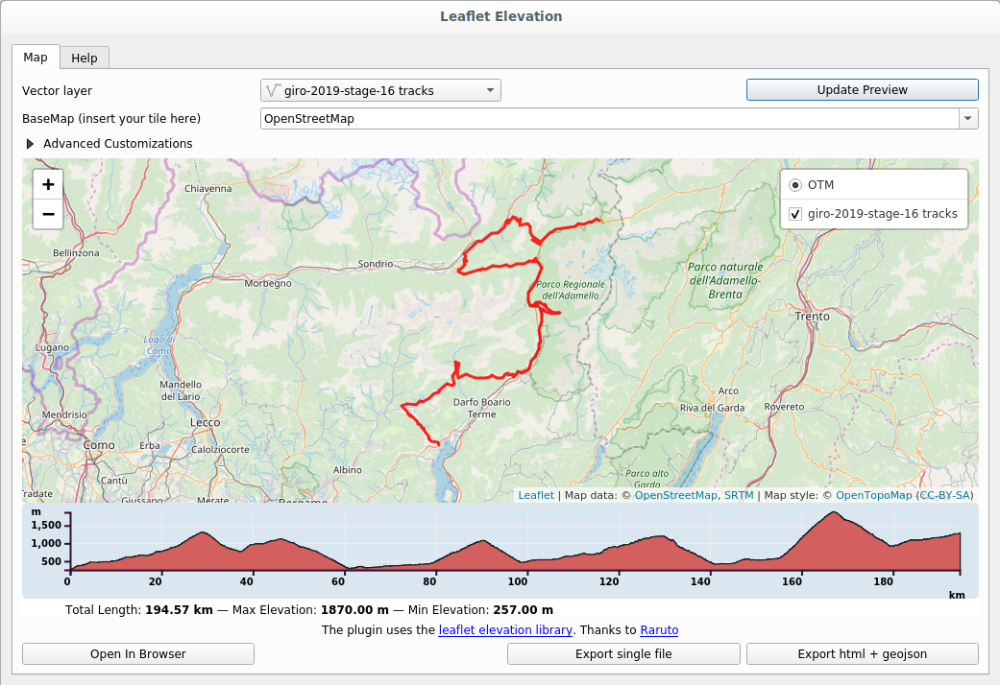

# QGIS TrackProfile2Web Plugin

Requires QGIS 4 with Qt WebEngine. The preview and exported pages load
Leaflet and leaflet-elevation 3.0.1 from a CDN, so they require internet access.
When exporting HTML and GeoJSON separately, serve both files over HTTP(S);
opening the HTML directly as a local file may block the GeoJSON request.

This plugin allows you to select a line layer and to create an
interactive elevation profile embedded within QGIS itself:



For 2D line layers, the plugin automatically fetches elevations from
[Mapterhorn](https://mapterhorn.com/), so an internet connection is required.
It creates a temporary 3D copy and leaves the original layer unchanged.
Mapterhorn attribution is included in the generated map.

The workflow is very simple:

1. select a **line** layer loaded in QGIS and choose a base map in the settings sidebar
2. optionally change the appearance or profile settings
3. the preview updates automatically. Navigate in the map and hover the mouse on the profile to
   see the position on the map

If you want you can export the map as a single `html` file or as `html` +
`geojson`. The settings panel is only shown inside QGIS and is not included in
the exported page. The results can be easily embedded in a web page.

The settings interface, map configuration and styles are defined in
`template.html`; `track_profile_2_web.py` handles QGIS integration and exports.

[Click to see a live example](https://www.faunalia.eu/it/dev/trackprofile2web).

Special thanks to [Raruto](https://github.com/Raruto) and his awesome [leaflet-elevation](https://github.com/Raruto/leaflet-elevation)
library!

## BDD tests

GitHub Actions runs the QGIS, browser and metadata scenarios on pushes and pull
requests.

Install `behave` in the QGIS 4 Python environment and Qt's `lrelease` on PATH
(required by the translation scenario). From an OSGeo4W shell:

```shell
python-qgis -m behave test\features --tags=qgis
```

The browser scenarios require `behave`, `playwright`, Google Chrome and
internet access. Run them and the metadata scenario with:

```shell
python -m behave test\features --tags="not qgis"
```
