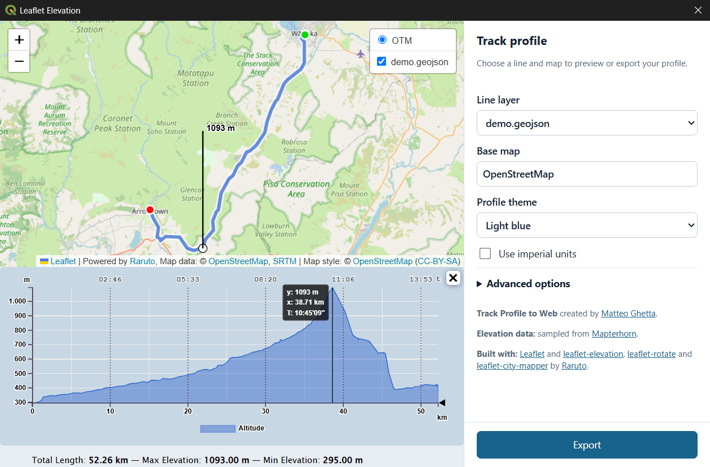

# TrackProfile2Web

A QGIS 4 plugin for interactive elevation profiles from line layers. Preview the
map in QGIS, then export it as a standalone HTML file or as HTML plus GeoJSON.



## Requirements

- QGIS 4 with Qt WebEngine and a browser.
- Internet access for the map libraries and, for 2D lines, Mapterhorn elevation
  data. Elevations are added to a temporary copy; the source layer is unchanged.
- Optional 3D terrain requires WebGPU, a secure browser context and a base map
  that allows CORS. If unavailable, the map falls back to 2D.

## Use

Select a line layer, choose a base map and adjust settings as needed. The preview
updates automatically; hovering over the profile highlights its location on the
map. Export settings are not included in the exported page.

When exporting HTML and GeoJSON separately, serve both over HTTP(S); browsers
may block the GeoJSON request when opening the HTML as a local file.

The preview runs on a temporary local server at `127.0.0.1`. Keep its address
private while QGIS is running; the server stops when the plugin is unloaded or
QGIS closes.

## Tests

Run QGIS scenarios from an OSGeo4W shell with `behave` installed in the QGIS
Python environment:

```shell
python-qgis -m behave test\features --tags=qgis
```

Run browser and metadata scenarios with `behave`, Playwright, Chrome and internet
access:

```shell
python -m behave test\features --tags="not @qgis and not @unit"
```

Run packaging and upload scenarios without QGIS or browser dependencies:

```shell
python -m behave test\features --tags=@unit
```

## Release

Set the `QGIS_USERNAME` and `QGIS_PASSWORD` GitHub Actions secrets, then push a
tag matching the version in `metadata.txt` (for example `1.3` or `v1.3`). The
workflow runs tests, packages the plugin, uploads it to QGIS and creates a
GitHub Release.

[Live example](https://www.faunalia.eu/it/dev/trackprofile2web) ·
[leaflet-elevation](https://github.com/Raruto/leaflet-elevation) by
[Raruto](https://github.com/Raruto)
